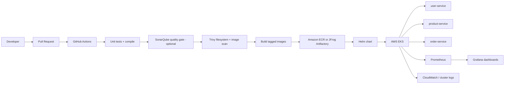

# Secure Cloud-Native Microservices Delivery Platform

A portfolio-ready DevSecOps reference project demonstrating three Python/FastAPI microservices, container builds, CI security gates, Kubernetes/Helm deployment, Terraform-managed AWS EKS infrastructure, a CloudFormation example, observability, and operational runbooks.

> **Important:** This repository is a deployable starter/reference implementation, not a claim that AWS resources have already been provisioned. Review and test all infrastructure in your own AWS account before applying it. AWS resources can incur charges.

## Architecture



## Services

| Service | Port | Example endpoint | Purpose |
|---|---:|---|---|
| user-service | 8001 | `/users/1` | Demo user lookup |
| product-service | 8002 | `/products/1` | Demo product catalogue |
| order-service | 8003 | `/orders/1` | Demo order lookup |

Each service exposes `/health`, `/ready`, and `/metrics`. The sample data is in-memory so the project can run locally without a database. This is intentional for a compact demo; replace it with a managed database for production.

## Repository layout

```text
.
├── services/                  # Three independently containerized FastAPI services
├── tests/                     # Basic API contract tests
├── helm/secure-platform/       # Helm chart for all services
├── k8s/                       # Standalone Kubernetes examples
├── terraform/                 # EKS/VPC/node group infrastructure
├── cloudformation/            # Optional ECR repository example
├── monitoring/                # Prometheus config and Grafana dashboard
├── .github/workflows/         # CI security pipeline
├── Jenkinsfile                # Alternative Jenkins pipeline
├── scripts/                   # Local helpers
└── docs/                      # Architecture, release, incident, Agile docs
```

## Run locally

Requirements: Docker + Docker Compose (or Python 3.11+).

```bash
docker compose up --build
```

Then test:
- http://localhost:8001/health
- http://localhost:8001/users/1
- http://localhost:8002/products/1
- http://localhost:8003/orders/1
- http://localhost:8001/metrics

Stop:
```bash
docker compose down
```

Run unit tests without Docker:
```bash
python -m pip install -r requirements-dev.txt
pytest -q
```

## Security and CI/CD

The GitHub Actions workflow:
1. Installs dependencies and runs tests.
2. Runs Trivy filesystem vulnerability/misconfiguration/secret scanning.
3. Builds each service image.
4. Scans images with Trivy and fails on CRITICAL/HIGH findings.
5. Uploads SARIF findings to GitHub Code Scanning when permissions allow.

The workflow does not publish images or deploy by default. This is safer for a public portfolio repository. Add registry credentials through GitHub Actions secrets and configure a protected deployment environment before enabling publication/deployment. See `docs/release-process.md`.

## AWS EKS infrastructure

The Terraform module creates a VPC, public/private subnets, NAT gateways, EKS cluster, and managed node group. The default uses one NAT gateway to reduce cost; for production, assess availability requirements and costs.

```bash
cd terraform
cp terraform.tfvars.example terraform.tfvars
# Edit region, cluster name, and node settings
terraform init
terraform fmt -check
terraform validate
terraform plan
# Apply only after reviewing estimated costs and permissions:
terraform apply
```

After provisioning, configure kubectl using the command printed in Terraform outputs or:
```bash
aws eks update-kubeconfig --region <region> --name <cluster-name>
```

**Cost warning:** EKS control plane, EC2 nodes, NAT gateways, load balancers, and data transfer may incur charges. Destroy resources when finished:
```bash
terraform destroy
```
Review the plan carefully before destroying anything.

## Deploy with Helm

Build and push images to your chosen registry, then update image repository/tag values in `helm/secure-platform/values.yaml` or supply overrides:

```bash
helm lint helm/secure-platform
helm template secure-platform helm/secure-platform
helm upgrade --install secure-platform helm/secure-platform \
  --namespace secure-platform --create-namespace \
  --set user.image.repository=YOUR_REGISTRY/user-service \
  --set product.image.repository=YOUR_REGISTRY/product-service \
  --set order.image.repository=YOUR_REGISTRY/order-service \
  --set user.image.tag=1.0.0 \
  --set product.image.tag=1.0.0 \
  --set order.image.tag=1.0.0
```

The chart uses non-root containers, read-only root filesystems, dropped Linux capabilities, resource requests/limits, probes, and a default-deny NetworkPolicy. Verify the CNI in your cluster enforces NetworkPolicy. Add explicit allow rules if service-to-service calls are introduced.

## Artifactory, SonarQube, Prometheus and Grafana

- Artifactory: see `docs/artifact-management.md` for repository naming, immutable tags, and secret configuration. Artifactory is an integration point; this project does not include Artifactory credentials.
- SonarQube: `sonar-project.properties` is a starter configuration. Configure a SonarQube server and quality gate in your CI environment to activate it.
- Prometheus: `monitoring/prometheus.yml` provides a scrape configuration. For EKS, consider kube-prometheus-stack and adapt service discovery.
- Grafana: `monitoring/grafana-dashboard.json` is an importable starter dashboard.
- CloudWatch: use the AWS CloudWatch Observability EKS add-on or Fluent Bit to ship cluster logs; see `docs/observability.md`.

## Portfolio / resume use

After you implement and validate this project, you can describe the work truthfully, for example:

**Secure Cloud-Native Microservices Delivery Platform | AWS, EKS, Terraform, Docker, Helm, GitHub Actions, Trivy, Prometheus, Grafana**
- Built three containerized FastAPI microservices and packaged Kubernetes deployments using Helm with health probes, resource limits, and hardened pod security settings.
- Automated test execution, filesystem and container image vulnerability scanning, and CI quality gates with GitHub Actions and Trivy.
- Provisioned a configurable AWS EKS foundation with Terraform and documented a CloudFormation example for registry infrastructure.
- Added Prometheus metrics, a Grafana dashboard starter, release/rollback procedures, and incident runbooks.

Only claim the AWS, Artifactory, SonarQube, dashboards, and deployments you personally configure and verify. Do not add fabricated performance metrics.

## Suggested implementation milestones

1. Run local compose and tests.
2. Create GitHub repository and push the code.
3. Enable GitHub Actions and resolve scanner findings.
4. Configure SonarQube and Artifactory (or use ECR as a simpler initial registry).
5. Review Terraform plan and deploy to a sandbox AWS account.
6. Deploy with Helm, test probes/rollback, and configure monitoring.
7. Capture your own architecture diagram, successful workflow run, scan results, and dashboard screenshots for the README.
